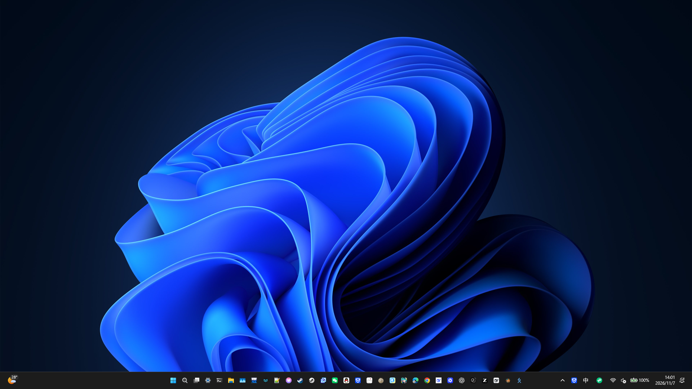
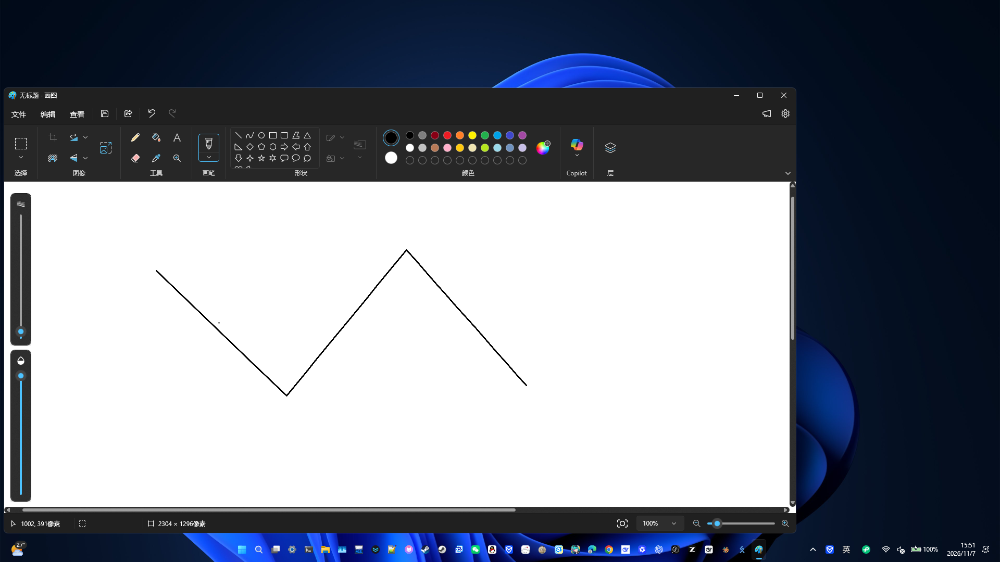
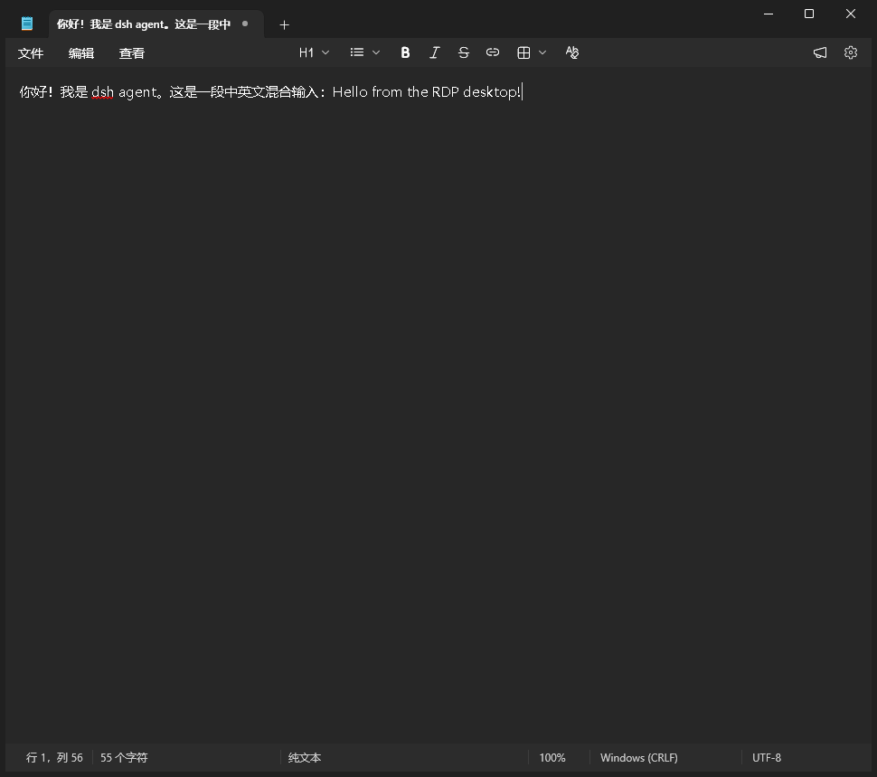
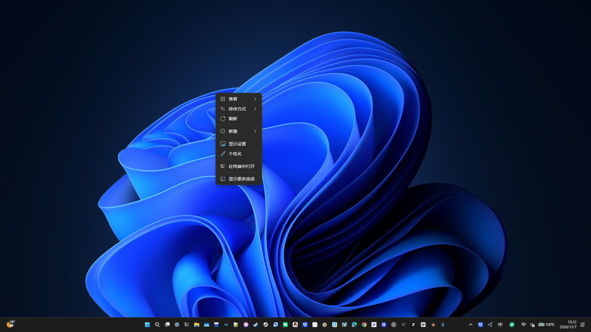
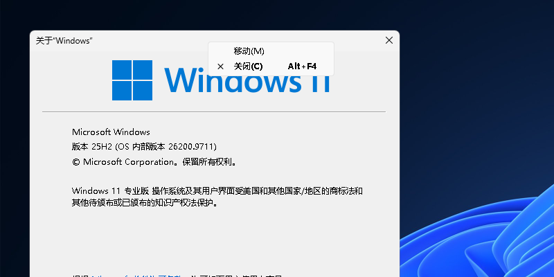

# dsh-rdp-wrapper

**给 dsh（DeepSeek Harness）agent 一个真实可交互的 Windows 桌面。**

装上这个插件，你的 dsh agent 就能像人一样"看到并操作"一台真正的 Windows 11 桌面：看屏幕、动鼠标、敲键盘、开程序、点菜单——全部是真实输入，不是模拟。



> 图：agent 得到的是一个**独立的 RDP 子会话桌面**，和你正在用的桌面互不打扰。

---

## 这是什么？

dsh（DeepSeek Harness）本身没有"看屏幕、点鼠标"的能力。这个插件补上它：

| 没有插件 | 装上插件后 |
| --- | --- |
| agent 只能执行命令行命令 | agent 能**看到**桌面（截图） |
| 打不开 GUI 程序、点不了按钮 | agent 能**操作** GUI：开程序、点按钮、填表单、拖文件 |
| 无法处理任何图形界面任务 | GUI 自动化任务（装软件、改设置、操作网页/桌面应用）都能交给 agent |

**agent 看到的桌面和你看到的是同一个 Windows，但不是同一个"会话"**：插件用 BetterGI「桌面分身」同款机制（`MsRdpClient10` ActiveX + `ConnectToChildSession=true`）从你当前的登录克隆出一个 RDP child session。克隆会话共享你的账号与文件，但桌面、键鼠、剪贴板是独立的——**你手上的鼠标键盘不会被抢走，你的桌面也不会被切走**。

### 它实际能做到什么（真实截图，全部来自实测会话）

**🖱️ 真实鼠标拖拽** —— 在画图中一笔一笔拖出线条：真实的 `SendInput` 点击与拖动，不是窗口消息模拟。



**⌨️ 中英文打字** —— 在记事本里直接输入中英混合文本（含中文的文本走剪贴板辅助输入，见[输入说明](#键盘输入的两种路径)）：



**📋 完整的右键菜单** —— 桌面右键后，`rdp_mouse rightclick` 会等菜单真正渲染完成再返回，紧接着的截图就是完整菜单（Win11 的 XAML 菜单渲染要 2–5s，插件自动等待）：



**🔍 区域截图** —— 也可以只截一个窗口或区域，方便 agent 精确定位：



---

## 5 分钟上手

### 你需要

- Windows 10/11 x64（Win11 `10.0.26200` 实测通过）
- dsh 桌面端（DeepSeek Harness Desktop）已安装并能正常对话
- 管理员权限（UAC；如果 UAC 是静默的，全程无弹窗）

### 第 1 步：把插件装进 dsh

1. 编辑 dsh 桌面端 profile 的 `package.json`（一般在 `~/.dsh/profiles/desktop/package.json`）：

   ```json
   {
     "dependencies": {
       "dsh-rdp-wrapper": "link:D:/workspace/dsh-rdp-wrapper"
     },
     "dsh.profile.bundles": ["dsh-rdp-wrapper"]
   }
   ```
   > `link:` 指向本仓库目录。如果放在别的盘/路径，改成你的实际路径。

2. **重启 dsh**。启动日志里应出现 `[dsh-rdp-wrapper] loaded: 12 tool(s) registered`。

### 第 2 步：一次性初始化（provision）

开一个**管理员** PowerShell，跑：

```powershell
powershell -NoProfile -ExecutionPolicy Bypass -File D:\workspace\dsh-rdp-wrapper\scripts\rdp-elevate.ps1 -Action provision -BridgeSource "D:\workspace\dsh-rdp-wrapper\scripts\bridge"
```

provision 只做初始化：建目录、拷贝 bridge 到 `C:\ProgramData\dsh-rdp-wrapper\bridge\`、写 config、确保远程桌面开关不拦路（`fDenyTSConnections=0`）。**不创建账号、不存任何密码、不注册自启任务。**

### 第 3 步：在 dsh 里让 agent 跑第一次

重启后的 dsh 对话里，直接对 agent 说：

```
用 rdp_doctor 体检，然后 rdp_connect 连接桌面，截图看看当前桌面。
```

成功的话你会看到 agent 返回一张 1920×1080 的桌面截图。第一次连接约 15–30s（建会话 + 编译 bridge），之后秒连。用完让 agent 跑 `rdp_disconnect` 清理干净。

---

## 工具一览（12 个）

| 工具 | 干什么用 |
| --- | --- |
| `rdp_doctor` | 只读体检：系统/权限/TermService/3389/child session 开关、host 与 bridge 状态 |
| `rdp_provision` | 一次性初始化（就是上面第 2 步，也可以直接让 agent 自己跑） |
| `rdp_connect` | 创建/复用 RDP 子会话并等 bridge 就绪（幂等，重复调用安全） |
| `rdp_status` | host 状态、会话列表、存活 bridge |
| `rdp_disconnect` | 登出子会话、清理 host 与残留文件 |
| `rdp_info` | 会话屏幕尺寸/用户/DPI |
| `rdp_screenshot` | full / region / window 截图，PNG 落盘并在对话里内联展示 |
| `rdp_mouse` | move / click / dblclick / rightclick / middleclick / drag / scroll |
| `rdp_key` | 打字（Unicode 文本，`\n` = 回车）与组合键（`win+r`、`ctrl+shift+esc`、`alt+F4`） |
| `rdp_window` | 窗口 list / focus / minimize / maximize / restore / close / move / resize / rect / wait |
| `rdp_exec` | 在会话内执行命令（有桌面和登录 profile，UTF-8 输出，GUI 程序可 `wait=false`） |
| `rdp_clipboard` | 读写会话剪贴板文本 |

标准节奏：**`rdp_doctor` → `rdp_connect` → 截图定位 → 操作 → 验证截图 → `rdp_disconnect`**。

---

## 键盘输入的两种路径

`rdp_key type` 按文本内容自动选路：

- **纯 ASCII**（英数、标点、`\t` `\r` `\n`）→ 真实按键（`SendInput` 逐字发送）。
- **含非 ASCII**（中文、日文、emoji…）→ **剪贴板辅助输入**：保存会话剪贴板 → 把文本放进剪贴板 → 发送 `Ctrl+V` → 尽力恢复原剪贴板。

为什么这么设计：实测发现 Win11 中文 IME 激活时，`SendInput` 的 VK_PACKET Unicode 按键会被 IME 改写成一串乱码（"桌桌桌桌"、圆点、豆腐块都出现过）。而粘贴路径完全不受 IME 影响，实测一字不差。返回的 `via` 字段（`keys` / `clipboard`）告诉你实际走了哪条路。

> **给 agent 的提示**：打字前先用 `rdp_mouse click` 点一下目标输入框，确保键盘焦点在里面 —— 新开的窗口焦点可能停在标题栏/标签条上，直接打字会"没有反应"。

---

## 它是怎么工作的？

```
dsh（你的桌面，console 会话）
│  lib/index.js            12 个工具 + 系统提示词
│  lib/bridge.js           桥接客户端（TCP 127.0.0.1，一连接一请求）
│        │ powershell.exe -File scripts\*.ps1
│        ▼
│  rdp-child-host.exe      提权常驻（WinForms，C# 5）
│    ├─ MsRdpClient10 + ConnectToChildSession ──────▶  RDP child session
│    │     无密码，会话随该 RDP 连接存活                 （当前登录用户的克隆）
│    └─ 临时计划任务 + IRegisteredTask::RunEx
│           TASK_RUN_USE_SESSION_ID ────────────────▶  child-bridge-launcher.ps1
│                                                         └─ rdp-bridge.ps1
│                                                              （会话内桌面操作）
└─ rdp_* 工具 ── TCP 127.0.0.1:<port> ────────────────────────┘
```

1. `rdp_connect` 以管理员启动 `rdp-child-host.exe`（UAC）。
2. host 用 `MsRdpClient10` ActiveX 连 `localhost`，扩展属性 `ConnectToChildSession=true` —— Windows 基于当前登录用户克隆出一个 RDP child session，**无需密码**；你正在用的 console 桌面不受影响。
3. host 用临时计划任务 + `RunEx(TASK_RUN_USE_SESSION_ID)` 在子会话里启动 bridge（PowerShell，运行时编译内嵌 C#），监听 127.0.0.1 随机端口，端口/令牌写入 `C:\ProgramData\dsh-rdp-wrapper\ports\bridge-session-<sid>.json`。
4. dsh 侧工具通过 TCP 调 bridge，bridge 在会话内完成截图 / SendInput / 窗口管理 / exec / 剪贴板。

### 常见疑问

**会影响我正在用的桌面吗？** 不会。console 会话不受影响，你的键鼠不会被切走；两个桌面各自独立。

**需要密码 / 专用账号吗？** 不需要。child session 克隆当前登录，无密码连接，不创建任何账号。

**agent 会动我开着的窗口吗？** 不会。agent 操作的是子会话里的桌面。插件提示词也要求 agent 只用 `process` 过滤自己启动的窗口。

**安全吗？** bridge 只监听 127.0.0.1，带 hello token 握手；提权动作走 UAC。子会话共享你的账号与文件权限——把它当作"一个有桌面的沙箱"，不要在涉密场景让 agent 随意操作。

**和直接跑 mstsc 有什么区别？** mstsc 路线需要密码/专用账号/rdpwrap 补丁，且会把你的桌面切走；child session 机制三者都不需要，这也是 BetterGI「桌面分身」采用它的原因。

---

## 已知限制

1. **会话级隔离，不是账号级隔离**：子会话克隆当前用户，共享 profile、文件、网络身份。`HKCU Run` 自启项会在子会话里再启动一遍（看到两份托盘程序属正常）；「登录时触发」的计划任务不会为子会话触发。
2. **同一时间只允许一个 host**（全局互斥体）；`rdp_connect` 会复用现存会话。
3. **Win11 XAML 右键菜单渲染慢**（2–5s，系统行为）：`rightclick` 默认自动等待（上限 6s），`waitPopup=false` 可跳过。
4. **含非 ASCII 的打字走剪贴板辅助**：会短暂占用会话剪贴板，尽力恢复原内容（极端情况下恢复可能晚于目标应用读取）。
5. **分辨率由 host 的 ActiveX 窗口决定**，默认取 config（1920×1080）；`rdp_connect` 的 width/height 可覆盖。
6. 会话只在 host 存活期间存在；残留会话由下次 connect/disconnect 清理。

## 故障排查

先跑 `rdp_doctor` 和 `rdp_status`，再看 `C:\ProgramData\dsh-rdp-wrapper\logs\` 下三个日志。

| 现象 | 排查 |
| --- | --- |
| `not provisioned` | 跑一次第 2 步的 provision |
| `no bridge found` | 先 `rdp_connect`；确认 `childhost.json` 的 `message` 与 `childSessionId` |
| `child host failed: ...` | 看 `logs\childhost.log` 末尾；常见为 UAC 被拒或 TermService 未运行 |
| `bridge did not come up within Ns` | 多数是首次编译慢/RunEx 令牌未就绪，**等 1–2 分钟再 `rdp_connect` 一次**（幂等）即可；仍失败看 `logs\launcher.log` |
| 点击无效 | 看 `rdp_mouse` 返回的 `via`（默认 `input`）；确认坐标来自最新截图；先点目标窗口把它带到前台 |
| 打字没反应 | 先点击目标输入框（焦点问题）；看返回的 `via`：中文走 `clipboard` 属正常 |
| 右键菜单在截图里看不到 | 看 `popup.found`；默认已等待渲染；XAML 菜单可能需要 2–5s |

## 验证状态（2026-11-07 本机实测）

| 项 | 状态 |
| --- | --- |
| 无密码创建 child session（ConnectToChildSession） | ✅ session 16–34 |
| 计划任务 + RunEx 启动 bridge | ✅（首次可能慢，重试机制兜底；超时就等 1–2 分钟重连） |
| `info` / `screenshot` / `window` / `exec` / `clipboard` | ✅ |
| 鼠标：真实 `SendInput` 点击、拖拽（画图折线）、桌面右键 | ✅ |
| 键盘：`win+r`、`enter`、`esc`、`alt+F4` | ✅ |
| 中英混合打字（中文 IME 激活时） | ✅ 0.4.3 修复 VK_PACKET 被 IME 改写的乱码 |
| 右键菜单自动等待（XAML / 经典 `#32768`） | ✅ XAML 约 2–6s，经典菜单 <200ms |
| 12 个工具经真实 `execute()` 全链路 connect → 操作 → disconnect | ✅ |
| 退出清理（host / child session / 计划任务 / 端口文件） | ✅ |

## 目录

```
lib/index.js                  dsh 插件入口（inject tools，注册 12 工具 + 系统提示词）
lib/tools.js                  工具定义与参数
lib/bridge.js                 bridge 发现 + TCP 客户端
lib/trace.js                  加载期诊断日志（DSH_RDP_TRACE=1 才写）
assets/                       README 演示截图
scripts/rdp-doctor.ps1        只读体检
scripts/rdp-elevate.ps1       提权包装器
scripts/rdp-elevated.ps1      提权动作：provision / logoff / enable-rdp
scripts/rdp-connect.ps1       创建/复用 child session 并等待 bridge
scripts/rdp-status.ps1        状态
scripts/rdp-disconnect.ps1    停止 host + 登出 + 清理
scripts/childhost/ChildHost.cs        宿主源码（ActiveX + 计划任务 RunEx）
scripts/childhost/build-childhost.ps1 用 .NET Framework csc 编译出 exe
scripts/childhost/start-childhost.ps1 提权启动 host
scripts/childhost/child-bridge-launcher.ps1 会话内校验 + 启动 bridge
scripts/childhost/rdp-child-host.exe  已编译的宿主（源码改动后需重新 build）
scripts/bridge/rdp-bridge.cs  桥接原生层（C# 5，运行时 Add-Type）
scripts/bridge/rdp-bridge.ps1 桥接逻辑层（PS 5.1）
cordis.patch.yml              dsh bundle patch
test/ps-check.ps1             PS 语法检查（开发用）
test/input-probe.ps1          鼠标注入自检（自建窗口，验证 SendInput/mouse_event）
test/rdp-rpc.mjs              直接调用 bridge 的开发客户端
test/drive-tools.mjs          不经 harness 直接驱动工具 execute()（开发自测）
test/window-probe.ps1         窗口树 / 前台窗口诊断
test/popup-growth.ps1         XAML 菜单出现时间与尺寸测量
```

## 给维护者

- 改 `lib/*.js` → 重启 dsh 才加载。
- 改 `scripts/bridge/*.ps1|.cs` → 重跑 provision，并断开重连（bridge 在会话启动时加载）。
- 改 `ChildHost.cs` → `scripts\childhost\build-childhost.ps1` 重编译。
- 开发自测：`node test/drive-tools.mjs <tool> '<json>'`；经 `execute()` 传参用工具层参数名（screenshot region 用 `width/height`，drag 用 `x/y/x2/y2`）。
